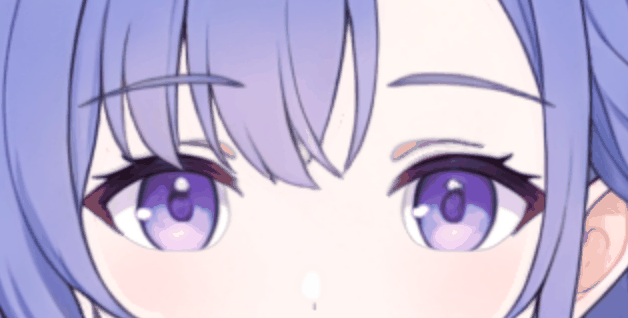

# Al2d

**Build Live2D models in Python, from a layered PSD to a model VTube Studio can load, without clicking through Cubism Editor.**

[中文说明](#中文说明)

Al2d writes Cubism Editor project files (`.cmo3`) directly: meshes, warp and rotation deformers,
parameters, keyforms, clipping masks and a texture atlas. It converts them to runtime files
(`.moc3`, `model3.json`, `physics3.json`) and checks the result by rendering it through Live2D's
Cubism Core. Rigging is done by *recipes* (blink, mouth, pupils, head turn and tilt, brows, mouth
form, hair sway, physics) that measure the artwork instead of relying on typed-in coordinates.
A short per-character script says which layers belong together and how much things move.
The `.cmo3` is a normal Cubism Editor project, so the result can still be fine-tuned by hand.

The code was written by an AI coding agent under my direction, and each new character is rigged
the same way: the agent writes that character's script, builds, looks at the check pictures and
adjusts.

## Demo

Qwen娘, a fan character, from one AI-generated picture to a model driven by face tracking in
VTube Studio: **https://www.bilibili.com/video/BV1suWr6DEYd/**

> That video was made on 2026-11-14 with an early version of this code. Since then the recipes
> have gained head tilt, brows, mouth form, eye smile and a blink rebuilt after a professional
> rig, so the video does not show what the code can do now. The newest results are on Live2D's
> official sample character Haru, which I cannot publish here because of the sample licence:
> [contact me](#contact) and I will share them.

 

## How it works

```
Human-drawn PSD ───────────────────────────────┐
  or one picture ─► See-through (AI layer split) ┤
                                                ▼
1. Art prep    al2d/artprep.py + characters/<name>/prep.py     → clean PSD
2. Rig         al2d/rigkit.py recipes + characters/<name>/build.py
               → al2d/cmo3writer.py (+ automesh, caff)          → .cmo3
3. Convert     Umamo (patched) → .moc3;  al2d/physics.py → physics3.json
4. Check       al2d/l2dcore.py renders through Cubism Core      → check pictures and GIFs
5. Install     --install copies the model into VTube Studio
```

Details: [docs/workflow.md](docs/workflow.md). File format notes: [docs/cmo3-format.md](docs/cmo3-format.md).
Preparing a PSD for rigging: [docs/psd-guide.md](docs/psd-guide.md).

| Folder | What is in it |
|---|---|
| `al2d/` | The library: `.cmo3` writer, CAFF container, meshes, rig recipes, art clean-up, physics, Core loader |
| `characters/` | One folder per character: `prep.py` (art clean-up) and `build.py` (rig) |
| `examples/` | Artwork for the two example characters |
| `tools/` | Inspecting and comparing `.cmo3` / `.moc3` files |
| `patches/` | Changes to Umamo needed for conversion |
| `docs/` | Workflow, format notes, PSD guide |

## Setup

Requirements: Python 3.11+, a JDK (21 or newer) for Umamo, and the Cubism Core library.

1. `pip install -e .`
2. Umamo: clone https://github.com/future2d/umamo at commit `b5cb72d`, apply the patch with
   `git apply patches/umamo.patch`, then build it once (`gradlew :cli:run`). The patch fixes two
   count fields Cubism Core checks, and adds `UMAMO_MOC_VERSION=V50` so the output is moc3
   version 5, the newest VTube Studio reads.
3. Cubism Core: `Live2DCubismCore.dll` from the
   [Cubism SDK for Native](https://www.live2d.com/en/sdk/download/native/), or the copy VTube
   Studio ships in `VTube Studio_Data/Plugins/x86_64/`. It is Live2D's proprietary library and is
   not included here.
4. Copy `al2d.example.toml` to `al2d.toml` and fill in the paths.

Build the examples:

```bash
python characters/girl/build.py              # -> out/girl_code/
python characters/lady/prep.py               # See-through layers -> cleaned PSD
python characters/lady/build.py --install    # -> out/lady_code/, and into VTube Studio
```

Each build writes the `.cmo3` project, the runtime model in `runtime/`, and check pictures
(`check_*.jpg`, `*.gif`) showing every parameter.

## What it can and cannot do

Written: art meshes, parameters, nested warp deformers, rotation deformers, keyforms on one or
several parameters, clipping masks, one texture atlas, `physics3.json`, `EyeBlink` / `LipSync`
groups.

Not yet: opacity or draw order that change with a parameter (needed for expressions that swap
drawings), a parts tree, several texture pages, glue, blend shapes, expression and motion files,
body and arm rigs.

Generated `.cmo3` files open in Cubism Editor 5.3 with no warnings: textures, deformer tree and
parameters all work there, so a rig built by Al2d can still be fine-tuned by hand.

## Contact

Rigging requests (send a layered PSD), questions, or to see the newest results:

- Email: handsomepwy@gmail.com
- [GitHub issues](https://github.com/handsomepwy/Al2d/issues)

## Licence and credits

GPL-3.0 (see `LICENSE`). Third-party work this builds on is listed in [NOTICE.md](NOTICE.md).
Live2D and Cubism are trademarks of Live2D Inc. This project is not affiliated with Live2D Inc.

---

## 中文说明

**用 Python 直接生成 Live2D 模型：从分层 PSD 到能在 VTube Studio 里用的模型，全程不需要在 Cubism Editor 里手动操作。**

Al2d 直接写出 Cubism Editor 的工程文件（`.cmo3`），包括网格、弯曲/旋转变形器、参数、关键帧、剪贴蒙版和纹理图集，再转换成运行时文件（`.moc3`、`model3.json`、`physics3.json`），并通过 Live2D 的 Cubism Core 渲染检查结果。绑定由一组"配方"完成（眨眼、嘴、眼珠、转头和歪头、眉毛、嘴型、头发摆动、物理），它们根据画面本身测量，而不是手填坐标。每个角色只需要一个简短的脚本，说明哪些图层是一组、动作幅度多大。生成的 `.cmo3` 是标准的 Cubism Editor 工程，可以直接在 Editor 里打开继续手动微调。

代码由 AI 编程助手在我的指导下编写；每个新角色也用同样方式绑定：AI 为这个角色写脚本、构建、看检查图、再调整。

**演示：** Qwen娘（同人角色），从一张 AI 生成的图到用面部捕捉驱动的模型：https://www.bilibili.com/video/BV1suWr6DEYd/

> 这个视频是 2026-11-14 用早期版本的代码做的。之后配方加入了歪头、眉毛、嘴型、眯眼笑，眨眼也参照专业模型重做了，所以视频并不代表现在的效果。最新的成果是在 Live2D 官方示例角色 Haru 上做的，受示例素材许可限制不能在这里公开，欢迎[联系我](#contact)查看。

**接绑定委托**（请提供分层 PSD）、提问或想看最新效果：邮箱 handsomepwy@gmail.com，或在 GitHub 提 issue。

安装和使用步骤见上方英文部分。
